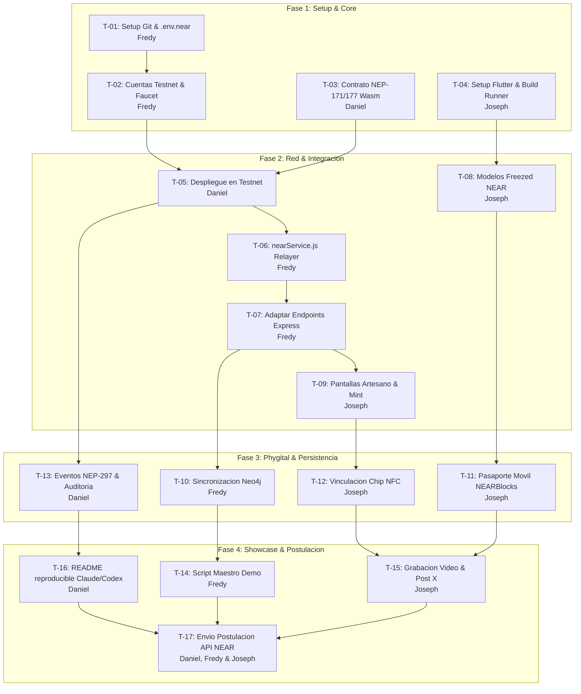

# Plan de Descomposición del Trabajo (Work Breakdown Structure — WBS)
## Migración E2E a NEAR Protocol & Flutter Mobile — Kipulux

Este documento define el grafo ordenado de dependencias de tareas atómicas para la migración técnica de Kipulux hacia **NEAR Protocol**, distribuido entre **Daniel** (Smart Contracts), **Fredy** (Backend & Web) y **Joseph** (Mobile & NFC).

---

## 1. Desglose Atómico de Tareas por Fase

### Fase 1: Infraestructura Base & Entorno (Días 1 - 4)

#### T-01: Configuración de Ramas Git y Manifiestos de Entorno
* **Responsable:** Fredy
* **Entregable:** Rama `feature/near-integration`, `.env.near.example`.
* **Comandos:** `git checkout -b feature/near-integration`

#### T-02: Creación de Cuentas NEAR Testnet y Fondeo
* **Responsable:** Fredy (apoyo Daniel)
* **Entregable:** Cuentas `kipulux-core.testnet` y `relayer.kipulux.testnet` fondeadas con NEAR testnet.

#### T-03: Desarrollo del Smart Contract NEP-171 / NEP-177 en Wasm
* **Responsable:** Daniel
* **Entregable:** Código fuente del contrato en Rust (`near-sdk-rs`) o TypeScript (`near-sdk-js`), compilable a `.wasm`.
* **Pruebas:** `cargo test` o `npm test` en sandbox.

#### T-04: Sincronización del Repositorio Móvil y Regeneración de Código
* **Responsable:** Joseph
* **Entregable:** `KipuLux-Mobile` en rama `feat/app-movil-flutter`, ejecución de `flutter pub get` y `dart run build_runner build`.

---

### Fase 2: Despliegue en Red, Relayer y Conexión Móvil (Días 5 - 8)

#### T-05: Despliegue en NEAR Testnet e Inicialización
* **Responsable:** Daniel
* **Entregable:** Contrato activo en `testnet.nearblocks.io/address/kipulux-core.testnet`, inicializado con `new(owner_id)`.

#### T-06: Servicio Relayer Backend (`services/nearService.js`)
* **Responsable:** Fredy
* **Entregable:** Módulo Node.js con `near-api-js` capaz de firmar transacciones `mint_authorized` con la clave del relayer.

#### T-07: Refactorización de Endpoints en Express
* **Responsable:** Fredy
* **Entregable:** `/api/productos/mintear` retornando `nearTxHash` y `token_id`.

#### T-08: Adaptación de Modelos Freezed en Flutter
* **Responsable:** Joseph
* **Entregable:** DTO `Pasaporte` con propiedades `nearTxHash`, `nearTokenId` y `receiptId`.

#### T-09: Integración de Pantalla de Artesano con NEAR
* **Responsable:** Joseph
* **Entregable:** `registrar_prenda_screen.dart` enviando datos y confirmando el minteo en NEAR con diálogo interactivo.

---

### Fase 3: Integración Phygital, Neo4j & Experiencia de Usuario (Días 9 - 11)

#### T-10: Sincronización Bidireccional con Neo4j
* **Responsable:** Fredy
* **Entregable:** Consultas Cypher actualizando nodos `Producto` con metadata de NEAR.

#### T-11: Visualización del Pasaporte Digital Móvil con NEAR Explorer
* **Responsable:** Joseph
* **Entregable:** `pasaporte_screen.dart` con tarjeta cyan de NEAR y botón que abre `testnet.nearblocks.io/txns/<nearTxHash>`.

#### T-12: Vinculación y Verificación de Chip Físico NFC
* **Responsable:** Joseph
* **Entregable:** `vincular_nfc_screen.dart` y `verify_screen.dart` operando contra la API.

#### T-13: Auditoría Criptográfica y Eventos NEP-297
* **Responsable:** Daniel
* **Entregable:** Emisión de logs estructurados `EVENT_JSON` para indexadores y comprobación del hash SHA-256 de SUNAT.

---

### Fase 4: Showcase, Automatización & Postulación (Días 12 - 14)

#### T-14: Script de Demostración E2E en 1 Comando
* **Responsable:** Fredy
* **Entregable:** `node scripts/demo/run-demo-near.js` ejecutable por los jueces.

#### T-15: Producción de Video Demostrativo y Post en X (Twitter)
* **Responsable:** Joseph (con apoyo de Fredy y Daniel)
* **Entregable:** Video de 2-3 min con demostración móvil y link al post público en X con tag `@NEARProtocol`.

#### T-16: Redacción de README para Evaluación Automática (Claude Code / Codex)
* **Responsable:** Daniel
* **Entregable:** `README.md` estructurado en pasos reproducibles "Haz X -> Observa Y", diff documentado (Q-002) y `LICENSE` MIT.

#### T-17: Validación de Payload y Envío de Postulación
* **Responsable:** Daniel, Fredy & Joseph
* **Entregable:** Confirmación HTTP 201 en `POST https://nearhackathon.com/api/applications`.
